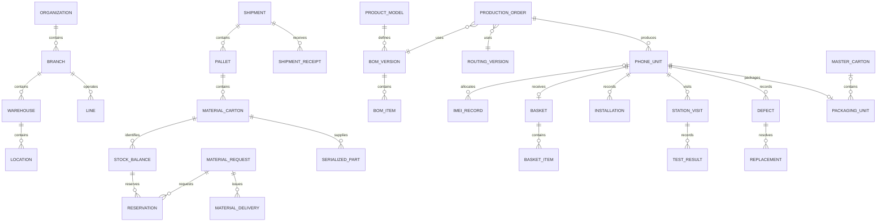

# مدل دادهٔ REVAL در P01

این مدل پیش‌نویس G1 است. شناسه‌های داخلی ObjectId و در API رشته‌اند. همهٔ رکوردهای دامنه `organizationId` دارند. زمان‌ها UTC هستند و تاریخ شمسی در رابط نمایش داده می‌شود. رکوردهای قابل ویرایش `createdAt`، `updatedAt`، `createdBy` و `version` دارند. سندهای عملیاتی، شناسهٔ عامل و سابقهٔ وضعیت را نگه می‌دارند. شاخص‌های یکتا در این جدول در سازمان اعمال می‌شوند، به‌جز IMEI که در کل نصب یکتاست.

در فهرست زیر فیلدها الزامی‌اند، مگر با `?` مشخص شده باشند. فیلدهای پایان/ابطال هنگام همان انتقال تکمیل می‌شوند. مقدار پیش‌فرض وضعیت در سند گردش وضعیت آمده است. مقادیر شمارشی اعداد صحیح‌اند. برای SKU با واحد کسری، مقدار با Decimal128 و در API با رشتهٔ اعشاری ارسال می‌شود. دقت و گام از نوع واحد می‌آیند.

| موجودیت | فیلدهای دامنه | شاخص‌ها و نگهداری |
|---|---|---|
| Organization | code، name، active=true | code یکتا در کل نصب. غیرفعال‌سازی. |
| Branch | code، name، managerId?، active=true | code یکتا. غیرفعال‌سازی. |
| User | usernameNormalized، displayName، passwordHash، active=true، mustChangePassword=true | usernameNormalized در سازمان یکتا. غیرفعال‌سازی، ابطال نشست‌ها. |
| Role و PermissionScope | Role: key، name، permissions[]؛ PermissionScope: userId، roleId، branchId?، warehouseId?، lineId?، stationId? | کلید نقش یکتا. ترکیب کاربر، نقش و محدوده یکتا. محدودهٔ کل سازمان نیازمند مجوز صریح است. |
| Session | userId، tokenHash، expiresAt، revokedAt? | tokenHash یکتا، TTL بر expiresAt. تغییر رمز یا غیرفعال‌سازی نشست‌ها را باطل می‌کند. |
| Supplier، PartType و Unit | code، name، active=true؛ Unit: scale، step | code برای هر نوع موجودیت یکتا. غیرفعال‌سازی با حفظ سوابق. |
| SKU | code، name، partTypeId، unitId، active=true | code یکتا. شاخص نوع قطعه و وضعیت. |
| ProductModel و Color | code، name، active=true؛ ProductModel: imeiSlots (۱ یا ۲) | code برای هر نوع یکتا. |
| BOMVersion و BOMItem | BOMVersion: modelId، revision، state؛ BOMItem: bomVersionId، skuId، quantity | modelId+revision و bomVersionId+skuId یکتا. نسخهٔ منتشرشده ثابت است. |
| Line، Station و RoutingVersion | Line: branchId، code؛ Station: lineId، code؛ RoutingVersion: modelId، lineId، revision، steps[] | کد خط در شعبه و کد ایستگاه در خط یکتا. نسخهٔ مسیر در مدل/خط یکتا. مراحل نسخهٔ منتشرشده ثابت‌اند. |
| Warehouse و Location | Warehouse: branchId، code؛ Location: warehouseId، code، allowedModelIds[]، allowedPartTypeIds[] | کد محل در انبار و کد انبار در شعبه یکتا. تنظیمات تأیید جانمایی در سرویس کنترل می‌شوند. |
| Shipment، ShipmentReceipt، Pallet و MaterialCarton | Shipment: supplierId، warehouseId، code، expectedLines[]، waybillFileId?؛ Receipt: shipmentId، code، acceptedLines[]؛ Pallet: shipmentId، code؛ Carton: palletId، skuId، code، quantity | کدهای اسناد و کارتن یکتا. Receipt ثبت‌شده حفظ می‌شود. کارتن پیش از تأیید با ثبت علت از محموله کنار گذاشته می‌شود. |
| StockBalance، StockLedger و Reservation | مطابق سند طراحی موجودی | قید یکتایی و نسخه طبق سند طراحی. گردش ثبت‌شده فقط با سند جبرانی اصلاح می‌شود. |
| MaterialRequest، MaterialDelivery و ReceiptDiscrepancy | Request: lineId، bomVersionId، quantity، lines[]؛ Delivery: requestId، issuerUserId، code، lines[]، receivedLines[]؛ Discrepancy: shipmentReceiptId? یا deliveryId?، lines[]، resolution? | کد حواله یکتا. هر مغایرت دقیقاً یک سند مبدأ دارد. تاریخچه حفظ می‌شود. |
| ProductionOrder | modelId، colorId، lineId، quantity، bomVersionId، routingVersionId، code | کد یکتا. نسخه‌های BOM و مسیر در سفارش قفل می‌شوند. |
| IMEIBatch و IMEIRecord | Batch: modelId، source، importSummary؛ Record: batchId، canonicalImei، slot، pairGroupId، phoneUnitId?، state | canonicalImei یکتا در کل نصب. شاخص مدل و وضعیت برای تخصیص. شماره پس از ابطال حفظ می‌شود. |
| PhoneUnit، Basket و BasketItem | Unit: orderId، unitCode، imeiRecordIds[]؛ Basket: phoneUnitId، code، assignedLineId؛ Item: basketId، skuId، stockOrigin، serializedPartId | unitCode و کد سبد یکتا. یک سبد برای هر واحد. شاخص فعال برای جلوگیری از تخصیص هم‌زمان یک قطعه به چند سبد. |
| SerializedPart و Installation | Part: skuId، code، sourceCartonId؛ Installation: phoneUnitId، stationVisitId، serializedPartId، removedAt? | code یکتا. نصب فعال برای هر قطعه یکتا. نصب و تعویض در تاریخچه باقی می‌مانند. |
| StationVisit، TestDefinition و TestResult | Visit: phoneUnitId، stationId، attempt، entryAt؛ Definition: key، revision، checklist[]؛ Result: phoneUnitId، visitId?، definitionId، attempt، answers[]، outcome | تلاش ایستگاه و نسخهٔ تعریف تست یکتا در محدودهٔ خود. نتیجه فقط با رکورد جایگزین اصلاح می‌شود. |
| Defect، Replacement، Rework و ReturnDocument | Defect: unitId، installationId?، reason؛ Replacement: defectId، oldPartId، newPartId؛ Rework: defectId?، unitId، targetStationId، reason؛ Return: supplierId، code، partIds[] | شماره سند مرجوعی یکتا. ارجاع به قطعهٔ معیوب حفظ می‌شود. یک پروندهٔ مرجوعی باز برای هر قطعه. |
| PackagingUnit و MasterCarton | Package: phoneUnitId، labelRevision، verifiedAt?؛ Carton: code، modelId، colorId، capacity، locationId?؛ عضویت فعال روی Package با cartonId? | کد کارتن یکتا. یک بستهٔ فعال برای هر گوشی. افزایش شمارندهٔ کارتن و ثبت عضویت در یک تراکنش. |
| HamtaRegistration | phoneUnitId، method، state، trackingCode?، externalEvidenceId?، attempts[] | شناسهٔ گوشی یکتا برای ثبت جاری. سوابق اقدام حفظ می‌شوند. |
| FileAsset، AuditEvent، CommandReceipt و OutboxEvent | File: objectKey، contentType، size، checksum؛ Audit: actorId، action، entityRef، outcome، at، correlationId؛ CommandReceipt طبق طراحی موجودی؛ Outbox: eventId، type، schemaVersion، aggregateRef، status | کلید فایل و eventId یکتا. Audit فقط افزایشی. نگهداری فایل و گزارش طبق سیاست D08. |

رکوردهای نمونه و شکل ورودی API در [OpenAPI اولیه](openapi.json) آمده‌اند. قواعد جابه‌جایی، هم‌زمانی و پاسخ تکرارپذیر در [طراحی موجودی](INVENTORY-DESIGN.md) آمده‌اند.

## توسعهٔ افزایشی توزیع

مطابق D01، توزیع در تحویل اول تعویق دارد. برای مرحلهٔ آینده، `DistributionOrder` می‌تواند در مجموعهٔ مستقل، با محدودهٔ انبار و ارجاع رشته‌ای به شناسهٔ کارتن محصول و گوشی عضو آن ثبت شود. شناسهٔ محصول و عضویت فعلی حفظ می‌شوند. در زمان تخصیص آینده، عضویت گوشی در کارتن جانمایی‌شده، محدودهٔ دسترسی و یکتایی تخصیص فعال در همان تراکنش بررسی می‌شوند.

آزمون `TEST-P01-DISTRIBUTION-ADDITIVE` در مجموعهٔ `basket.integration.js` نسخهٔ `64d6b81` پاس شد. این آزمون یک سند نمونهٔ افزایشی را با شناسه‌های واقعی fixture نوشت، عضویت گوشی را از API محصول بازیابی کرد و برابری فهرست موجودی پیش و پس از درج را بررسی کرد.
